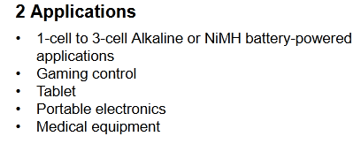
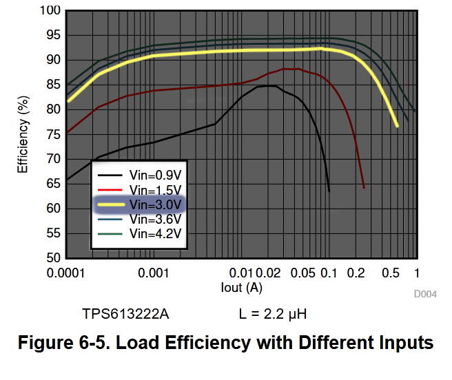
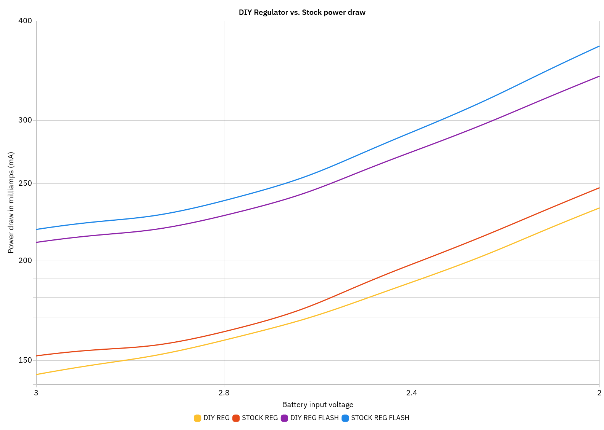
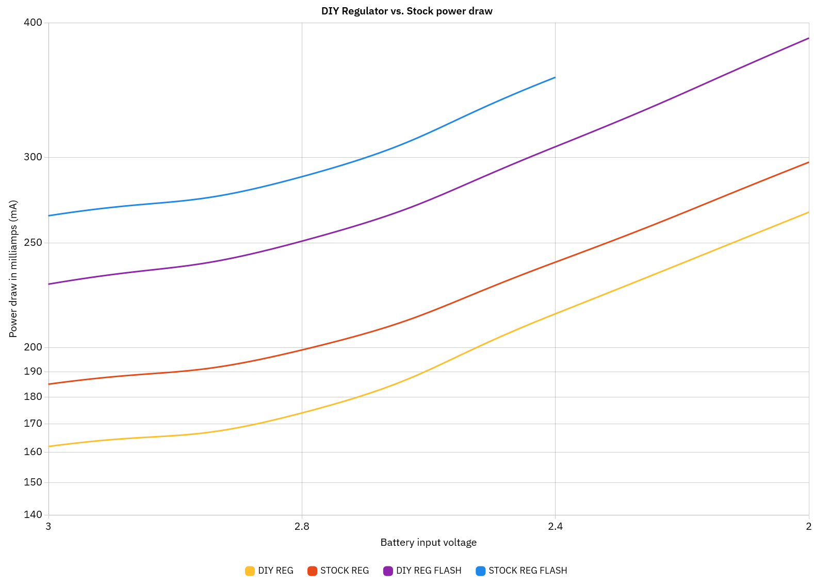

# DIY-Regulator

I have always wanted to make a solder practice board that is actually useful and here it is!

The DIY regulator is a Game Boy Pocket, Color or Pocket Color regulator that provides 5V - meaning it does not work with the OEM screens.

## Parts
---------------------------
| Designator | Part             | Footprint | Link |
| ---------- | -----------      | ----      | ---  |
| C1         | 10nF             | 0603      | [Mouser](https://au.mouser.com/ProductDetail/Murata-Electronics/GRM1857U1A103JA44D?qs=MY6wChARw2zuf1nfg9IsQA%3D%3D) [Digikey](https://www.digikey.com/en/products/detail/murata-electronics/GRM1857U1A103JA44D/2610988?s=N4IgTCBcDaIOICUCyBGAHAVgOwFUUEEUAGAZgCl8AWSgERAF0BfIA) [LCSC](https://www.lcsc.com/product-detail/C2170650.html)     |
| C2, C3, C4 | 10uF             | 0805      | [Mouser](https://au.mouser.com/ProductDetail/Samsung-Electro-Mechanics/CL21A106KPFNNNG?qs=hqM3L16%252BxldOAmVBBJhBjg%3D%3D) [Digikey](https://www.digikey.com/en/products/detail/samsung-electro-mechanics/CL21A106KPFNNNG/3894419) [LCSC](https://www.lcsc.com/product-detail/C17024.html)     |
| R1         | 100R             | 0603      | [Mouser](https://au.mouser.com/ProductDetail/YAGEO/RC0603FR-07100RL?qs=NEN%2FsE%2FLsvPIwIWKCOS4%2FA%3D%3D) [Digikey](https://www.digikey.com/en/products/detail/yageo/RC0603FR-07100RL/726888) [LCSC](https://www.lcsc.com/product-detail/C105588.html)     |
| L1         | 2.2uH            | 1008      | [Mouser](https://au.mouser.com/ProductDetail/Murata-Electronics/DFE252012F-2R2M%3dP2?qs=ty6qhqyUUEuYhdA0a9%2F0aw%3D%3D) [Digikey](https://www.digikey.com/en/products/detail/murata-electronics/DFE252012F-2R2M-P2/5812591?s=N4IgTCBcDaICIDECiYCsYAMBGMCC0YASmALIgC6AvkA) [LCSC](https://www.lcsc.com/product-detail/C576403.html)     |   
| U1         | TPS613222A       | SOT-23    | [Mouser](mouser.com/ProductDetail/Texas-Instruments/TPS613222ADBVR) [Digikey](https://www.digikey.com/en/products/detail/texas-instruments/TPS613222ADBVR/8638376) [LCSC](https://www.lcsc.com/product-detail/C2071163.html)     |

### Explanation

I want part of this project to be a little educational and explain how to read a datasheet and a rough explanation of things.

*DISCLAIMER: I am self taught, so I don't know the physics behind electricity and this might blow up your house (doubt, but it might)*

**TPS613222A** [Data Sheet](https://www.ti.com/lit/ds/symlink/tps61322.pdf)

I chose this boost converter mostly because of the footprint and because I like Texas Instruments parts. I find them very reliable and their datasheets are excellent. 

When you open a datasheet, page one usually has a summery of the part and what it is designed to be used in. This isn't a strict guideline, but helps you get a rough idea if it will be good for your project. 

*perfect! 1-3 NiMh (Ladda, Enloop) or Alkaline (standard AAs)*

Another part of a datasheet you should look at when choosing a part, are the graphs that show how the device performs in under specific conditions. For a Game Boy Color, the original device takes 2xAA batteries in a series. When batteries are in a series, their voltages are added together. 1xAA is 1.5V, so two (that the GBC takes) is 3V. 

*highlighted to make it easier to read*

The Game Boy Color will run between 0.1A and 0.3A which is the sweet spot of this part!

### Tests

I tested the DIY Regulator on a Game Boy Color and Game Boy Pocket. 
The tests were completed using Pokemon Red on the Pocket and Pokemon Crystal on the Color. A set of values were collected using the retail carts and a generic flash cart (the kind with a micro sd) Full volume, Q5 HiSpeedido screens and 50% brightness. The results recorded were the mean of values on the title screen.

#### Game Boy Color

